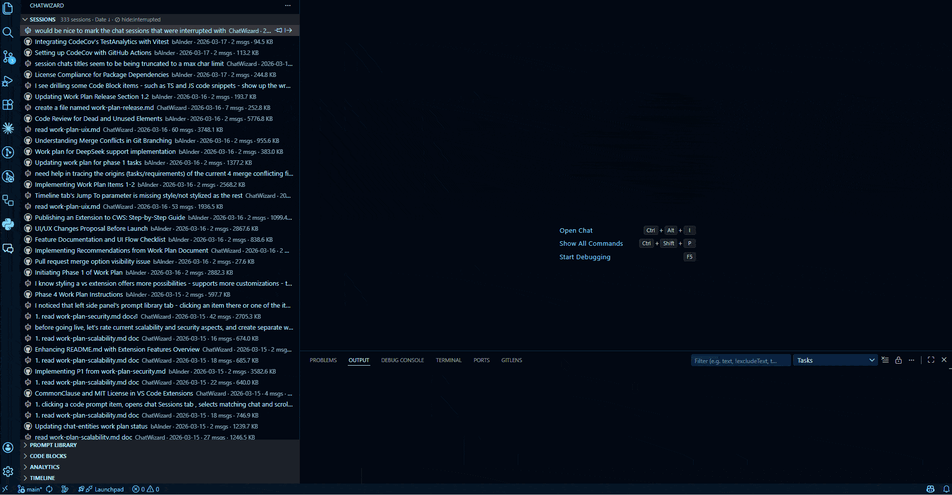
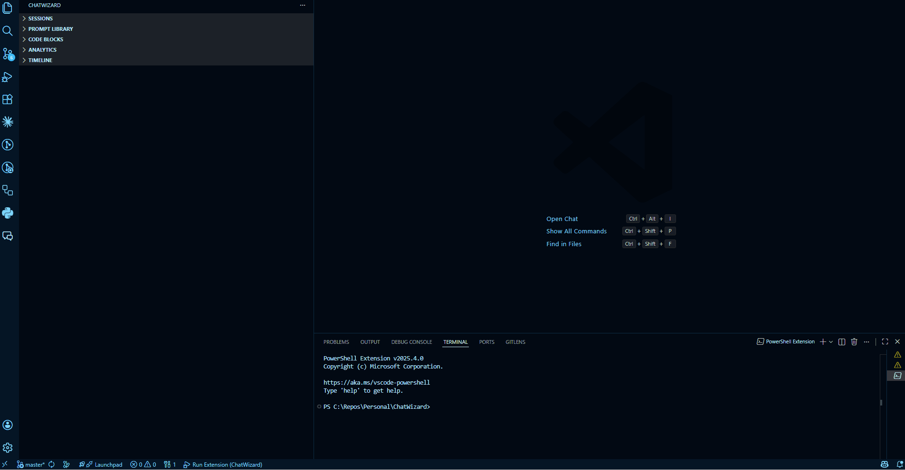
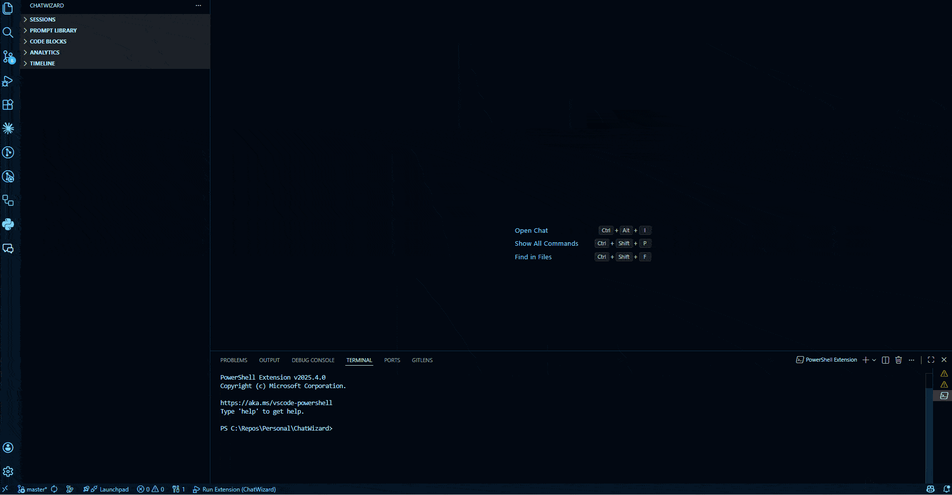

# 🐿️ Chat Wizard

**Every AI chat you have ever had — searchable, reusable, and finally in one place.**

Chat Wizard is a VS Code extension that turns the chat history your AI tools leave on disk into a single, local, searchable archive: browse it, search it, mine it for prompts and code, and feed it back to your AI assistant as context.

[User Guide](docs/user-guide.md) · [Changelog](CHANGELOG.md) · [Troubleshooting](docs/troubleshooting/) · [Report an issue](https://github.com/veverke/chatwizard/issues)

---

## The problem

You ask an AI a really good question. Three weeks later you need the answer again — and it is buried in a chat window you cannot search, in a different IDE, from a tool you no longer use.

Every AI coding assistant stores its history in its own private format, scoped to its own workspace, and prunes it whenever it feels like it. **Chat Wizard fixes that.**

- **One archive, every tool.** GitHub Copilot, Claude Code, Cline, Roo Code, Cursor, Windsurf, Aider, Google Antigravity, Continue.dev, Amazon Q Developer, Gemini Code Assist and Tabnine — indexed together, searchable together.
- **Local and read-only by default.** Your sessions never leave your machine, and Chat Wizard never modifies the files your AI tools wrote.
- **More than a viewer.** Keyword and semantic search, a deduplicated prompt library, a code-block library, token analytics, a timeline, an agent-action explorer and a knowledge base — things none of the source tools give you.
- **Context on tap.** Feed your history back to any MCP-capable assistant (Copilot, Claude, Cursor, Continue) so it can answer "what did we decide about X?" — and be right.

> **Zero setup for standard installs.** No account, no API key, no configuration. Install, open the sidebar, and your existing sessions are already there.

---

## See it

| Search across every session | Reuse any prompt | Understand your usage |
|---|---|---|
|  |  |  |

More demos: [export to Markdown](images/demos/export-to-markup.gif) · [session filters](images/demos/session-filters.gif) · [code blocks](images/demos/code-blocks.gif) · [model usage](images/demos/model-usage.gif)

---

## Table of contents

- [What you get](#what-you-get)
- [Feature tour](#feature-tour)
- [Supported AI tools](#supported-ai-tools)
- [Install](#install)
- [Try this first](#try-this-first)
- [Chat Wizard vs. native chat panels](#chat-wizard-vs-native-chat-panels)
- [Privacy & how it works](#privacy--how-it-works)
- [Known limitations](#known-limitations)
- [What's new](#whats-new)
- [Contributing](#contributing)
- [License](#license)

---

## What you get

Eight panels under one Activity Bar icon:

| Panel | What it is for |
|---|---|
| **Sessions** | Every conversation from every tool, grouped, sorted, filtered, tagged, filed and archived |
| **Prompt Library** | Every prompt you have ever typed, deduplicated and clustered by similarity |
| **Code Blocks** | Every fenced snippet the AI ever produced, filterable by language and content |
| **Commands** | What your agent *did*: terminal commands with exit codes, tool calls, a unified action timeline, and a visual diff explorer |
| **Knowledge Base** | Sessions classified into decisions, learnings, patterns, gotchas and architecture — with a dashboard and Markdown export |
| **Analytics** | Token estimates, daily activity, top projects and terms, longest sessions |
| **Model Usage** | Per-model request counts with workspace and session drill-down |
| **Timeline** | A chronological feed with an activity heat map, work bursts, streaks and topic drift |

Plus: a rich **session reader**, **file-centric history** (which sessions touched this file?), **standup digests**, an **MCP server**, a **REST API**, **Obsidian / Notion / HTML export**, and optional **encrypted cloud backup**.

---

## Feature tour

### 🔍 Find anything you ever asked

- **Full-text search** across every message, with ranked snippets and jump-to-match. Prefix your query with `/` for **regex** search, and filter by source or by prompts/responses only.
- **Semantic search** ("find sessions *about* connection pooling", even if those words never appear) using a small model that runs **fully offline** after a one-time ~22 MB download. Behind a proxy or an air-gapped network? Point Chat Wizard at a **mirror host** or a **local model folder** — or let it fall back gracefully to keyword search.
- **SQLite + FTS5 persistent cache** so 10,000-session archives open in under a second, and only changed files are re-parsed.

### 🗂️ Organize a year of history in minutes

- **Group** by date, **git branch**, **work item** (Jira / Azure DevOps / GitHub issue IDs via `chatwizard.workItemPattern`), **tag**, or **folder**; **sort** by date, title, workspace, length or model, with multi-key sort.
- **Filter** by title, date range, model, source, message count, status, tags — or show only interrupted sessions / sessions with warnings.
- **Pin**, **drag-and-drop into nested folders**, **tag** (`#bugfix`, `topic:auth`), mark **Open / Resolved / Revisit**, and **archive** sessions so they survive even when the source tool prunes them. Retention limits hide old history without deleting a single source file.
- **Bookmark messages** inside a conversation, **annotate** any turn with your own notes, and **link related sessions** to each other (links are stored in the shared metadata).

### 📖 A reader built for long conversations

- Syntax-highlighted transcripts, clickable links (bare URLs included), and `P1`/`R1` turn labels with **copy-as-reference** for quoting a turn in a new chat.
- **In-transcript search** that automatically loads the *entire* conversation (not just the first 50 messages) before reporting matches, plus a **Load all messages** button.
- **Per-response Commands chip** — every reply that triggered agent actions carries a collapsed chip summarising what ran (*2 git cmds · 3 tool calls · 1 failed*); expand it to inspect the commands, tool calls, file changes and errors, and click any row to open its details.
- **Remove a turn** you do not want to keep: the conversation and every index update accordingly, while an **original full conversation** link can always rebuild the untouched chat from the local database.
- **Entities** row: auto-extracted files, functions, errors, decisions, URIs and LLM-detected tools/frameworks/languages — pick one and the reader jumps to it.

### ♻️ Reuse instead of re-asking

- **Prompt Library**: exact duplicates collapsed, near-duplicates clustered, frequency-ranked, searchable, one-click copy.
- **Code Blocks**: every snippet archived, filterable by language, content, source and role, copyable in one click, and clickable back into its original conversation.

### 📊 Understand cost, cadence and topics

- **Analytics**: token estimates, daily activity, per-source session cards, top projects, top terms, longest sessions.
- **Model Usage**: which models you actually lean on, per workspace and per session, over any date range.
- **Timeline**: heat map, 2-hour work bursts, weekly topic drift, streaks, "on this day", inline keyword search.

### 🤖 See what your agent actually did

The **Commands** panel captures the *actions*, not just the conversation — from GitHub Copilot (including the new agent-host logs), Cline / Roo Code (including Cline 4.x), Aider and Windsurf:

- **Terminal Commands** — every shell, git, build and test command with exit codes, plus **Run in Terminal**.
- **LLM Tool Calls** — structured tool invocations, labelled as `toolName [target]` so a wall of `view` calls is readable.
- **Unified Timeline** — commands, file operations, diffs, tool calls, errors and planner steps interleaved as they happened.
- **Diff Explorer** — every changed file, expandable into its edits, opening in VS Code's **native side-by-side diff**.
- One shared filter bar (free text, by agent, failures only, event kind) and **Show Agent Log Stats** for per-agent / per-session totals and command success rates.
- The same data appears *inside* the conversation as a per-response **Commands** chip: the reader answers "what did this reply actually run?" without a sidebar trip.

### 🧠 Turn history into knowledge

- **Knowledge Base** classifies sessions into decisions, learnings, patterns, gotchas and architecture using the free Copilot LM API, with a heuristic/embedding fallback when no LLM is available. Doughnut dashboard, drill-down table and an Obsidian-compatible Markdown export.
- **Session summaries** (Chronicle → LM API → offline TF-IDF) shown in the tree tooltip and the reader header.
- **Workspace Digest** builds a standup / PR-description draft for *today*, *this week* or *this sprint*, grouped by branch and model.

### 🔌 Connect your assistant to your history

- **MCP server** (opt-in, localhost-only, bearer-token protected) with **11 tools** — search, similar-session lookup, session fetch, recent sessions, context assembly, file/branch/work-item queries — and **4 prompts** for MCP clients such as Claude Desktop, Cursor and Continue.
- **`@chatwizard` Copilot participant** with `/queryHistory`, `/continueFromHistory`, `/getPrompts`, `/referMessage`, `/tag` and `/removeTags` — no server required.
- **REST API** (opt-in) for scripts and dashboards: `/v1/sessions`, `/v1/sessions/search`, `/v1/stats`, `/health`.
- **Export** to Markdown (single, batch, combined, excerpt), **Obsidian**, **Notion**, or a self-contained **HTML** file; **inject any session as context** into a new Copilot chat; optional **AES-256-GCM encrypted backup** to a private GitHub Gist.

### 📍 Meet you where you are

- **File History**: a status bar counter and a CodeLens on every file that AI sessions touched, plus Explorer right-click → *Show File Session History*.
- **Workspace management**: choose exactly which Copilot / Claude workspaces get indexed.
- **Active-session tagging** from the status bar, and a 🐿️ *Did you know?* nudge that surfaces features you have not tried yet.

---

## Supported AI tools

| Tool | Where Chat Wizard reads from |
|---|---|
| **GitHub Copilot Chat** | Per-workspace `workspaceStorage/<hash>/chatSessions/*.jsonl`, workspace metadata from `state.vscdb`, **and** the newer agent-host layout in `<COPILOT_HOME>/session-state/<id>/` (scoped by the chat's `cwd`) |
| **Claude Code** | `~/.claude/projects/**/*.jsonl` |
| **Cline** | `tasks/<id>/` in extension storage **and** the Cline 4.x layout in `~/.cline/data/sessions/<id>/` |
| **Roo Code** | `tasks/<id>/` in extension storage (Cline-compatible format) |
| **Cursor** | `state.vscdb` → `composer.composerData` (native SQLite driver with a WASM fallback) |
| **Windsurf** | `state.vscdb` → `cascade.sessionData` (same driver) |
| **Aider** | `.aider.chat.history.md` in your workspace folders and any `chatwizard.aiderSearchRoots`, with the model read from `.aider.conf.yml` |
| **Google Antigravity** | `~/.gemini/antigravity/brain/<uuid>/.system_generated/logs/overview.txt` (JSONL) and `.pb` protobuf logs |
| **Continue.dev** | `~/.continue/sessions/` |
| **Amazon Q Developer** | Platform-aware discovery under `~/.aws/amazonq/` |
| **Gemini Code Assist** | The Gemini Code Assist extension's `globalStorage` |
| **Tabnine Chat** | The Tabnine extension's `globalStorage/chat` |

Every source participates in search, the Prompt Library, Code Blocks, analytics, the timeline, the archive and the MCP/REST APIs. Each source has an on/off toggle and (where relevant) a custom-path override.

> **Compacted Claude Code sessions** are detected and badged `· compacted`; the reader shows the remaining transcript plus the compaction summary.

> **Not yet indexed:** Zed AI (parser exists, ingestion is not wired up yet).

---

## Install

1. **VS Code Marketplace** — search for **ChatWizard** in the Extensions view and click *Install* (or install from [Open VSX](https://open-vsx.org/extension/Veverke/chatwizard) in VSCodium / Cursor / Windsurf).
2. **From a VSIX** — *Extensions: Install from VSIX…* from the Command Palette.
3. Open the **Chat Wizard** icon in the Activity Bar. Sessions are indexed automatically on startup (`onStartupFinished`).

**Requirements:** VS Code **1.85+** and at least one supported AI tool installed. No account, no API key, no extra setup.

---

## Try this first

1. **Search a year of history.** `Ctrl+Shift+P` → *Chat Wizard: Search… → Full-Text Search* → type `ECONNREFUSED`, or `/handleAuthError` for regex.
2. **Find the snippet, not the chat.** Open **Code Blocks**, filter to `typescript`, and click a block to jump straight into its conversation.
3. **Reuse your best prompt.** Open **Prompt Library**, search `refactor`, copy the prompt, paste it into today's chat.
4. **Ask about a file.** Right-click any file in the Explorer → *Chat Wizard: Show File Session History*.
5. **Give your assistant memory.** Enable `chatwizard.mcpServer.enabled`, then *Chat Wizard: Settings… → Copy MCP Config to Clipboard* and paste the snippet into Claude Desktop or Cursor.

---

## Chat Wizard vs. native chat panels

| Capability | Chat Wizard | Copilot Chat panel | Claude Code (terminal) |
|---|:---:|:---:|:---:|
| All sessions across all tools and workspaces | ✅ | ❌ per-workspace | ❌ no GUI history |
| Cross-session full-text + regex search | ✅ | ❌ | ❌ |
| Semantic ("find sessions about…") search | ✅ | ❌ | ❌ |
| Multi-key sort, pinning, folders, tags, status | ✅ | ❌ | ❌ |
| Session archive when a tool prunes history | ✅ | ❌ | ❌ |
| Message bookmarks, notes, removable turns | ✅ | partial | ❌ |
| Deduplicated prompt library & code-block library | ✅ | ❌ | ❌ |
| Token analytics, model usage, timeline heat map | ✅ | ❌ | ❌ |
| Agent action log (commands, tool calls, diffs) | ✅ | current session only | terminal scrollback |
| Per-file / per-branch / per-work-item history | ✅ | ❌ | ❌ |
| Knowledge base + standup digest | ✅ | ❌ | ❌ |
| Export to Markdown / Obsidian / Notion / HTML | ✅ | ❌ | copy-paste |
| Expose history to any AI client (MCP, REST) | ✅ | ❌ | ❌ |

---

## Privacy & how it works

- **Local by default.** All indexing, searching and analytics run on your machine. Nothing is uploaded, and there is no account or telemetry service.
- **Read-only toward your tools.** Chat Wizard only reads the session files your AI tools write — it never edits them. It keeps its own sidecar metadata, SQLite cache and archive under its global storage folder (or `chatwizard.sharedCacheDir` if you want to share them across IDEs).
- **Live updates.** File watchers pick up new and changed sessions (including in-progress chats) and refresh the views.
- **The only network access** is opt-in or one-off: the semantic model download (once, verified), optional cloud sync to *your* GitHub Gist, the local MCP/REST servers (bound to `127.0.0.1`), and a daily Marketplace update check.
- **MCP & REST are hardened.** Bearer-token auth, bound to loopback, read-only endpoints, token stored in VS Code secret storage and never logged.

---

## Known limitations

- **Token counts are estimates** (characters ÷ 4 for Claude/Gemini-style models, words × 1.3 for GPT-style models) — not billing-accurate.
- **Cursor and Windsurf use private SQLite schemas** that can change in any release; a future IDE update may need a matching Chat Wizard update.
- **Semantic search needs the model** (~22 MB). Without it, keyword search, the tree, analytics and MCP keyword tools keep working; only similarity search is disabled.
- **Knowledge Base quality tracks LLM availability**: excellent with the Copilot LM API, noticeably coarser with the heuristic fallback (e.g. in Cursor).
- **Search-panel source filter** cycles through Copilot, Claude, Antigravity, Cursor, Cline, Roo Code, Windsurf and Aider; other sources are still searched under *All*.
- **Removing turns requires the persistent cache** (`chatwizard.enablePersistentCache`, on by default) — removal is persisted in the chat database.
- **Cloud Sync** ships with a GitHub Gist backend; S3 and Azure Blob are interfaces awaiting implementation.

---

## What's new

**1.7.x — the agent-action release**
- **Watch agent logs**: a new **Commands** panel with **Terminal Commands**, **LLM Tool Calls**, **Unified Timeline** and **Diff Explorer**, shared filters, *Run in Terminal*, native diffs and stats.
- **New Copilot (agent-host) and Cline 4.x storage support**, with correct per-workspace scoping and live updates.
- **Bullet-proof semantic model download**: mirror hosts, local model folders, proxy/TLS-certificate support, multi-source fallback, atomic verified downloads, and graceful degradation with one actionable notification.
- **Incremental embedding fix** — only new and changed chats are embedded.
- Squirrel *Did you know?* nudges (default: every 10 minutes).

**1.6.0 — the structure release**
- SQLite + FTS5 persistent cache, folder organisation, command-palette categories, session status, bookmarks, annotations, session linking, Cloud Sync, REST API, Workspace Digest, session archive, knowledge base, HTML sharing and Tabnine support.

See **[CHANGELOG.md](CHANGELOG.md)** for the full history.

---

## Contributing

Issues and pull requests are welcome at [github.com/veverke/chatwizard](https://github.com/veverke/chatwizard). Found a bug or want a feature? [Open an issue](https://github.com/veverke/chatwizard/issues) — every report is read.

If Chat Wizard saves you time, a ⭐ review takes 30 seconds and genuinely helps:
[VS Code Marketplace](https://marketplace.visualstudio.com/items?itemName=Veverke.chatwizard&ssr=false#review-details) · [Open VSX](https://open-vsx.org/extension/Veverke/chatwizard) · [User survey](https://forms.gle/Mj4JtMsYLdxQds1R6)

---

## License

**MIT License with Commons Clause** — see [LICENSE](LICENSE). In plain terms: use, copy, modify and distribute the source freely; you may **not** sell the software or offer it as a paid product or service. This is source-available software, not OSI-certified open source.
